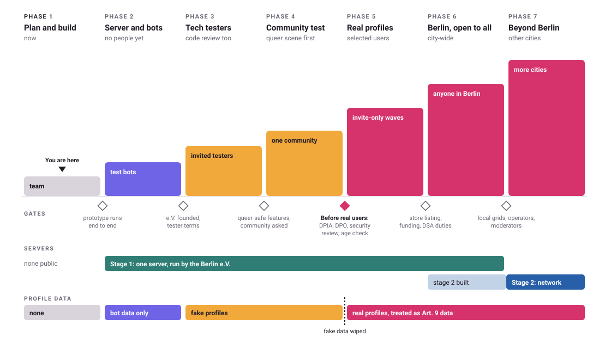

# Project phases

*Proposed by Hendrik on 12 Oct 2026. Seven phases, from planning to cities beyond Berlin. Each
phase says who uses the app, what data is in it, which server setup runs it, and what has to be
true before the next phase starts. Every spec and research doc points back here for "which phase
does this matter in".*

## Phases and stages are two different things

- **Phases** (this doc) say *who* uses the app and *what data* is in it: nobody, bots, testers
  with fake profiles, then real people.
- **Stages** (see [spec 12](spec/12-stage-2-network.md)) say *how many servers* run it. Stage 1
  is one server run by the Berlin e.V.; stage 2 is a network of vetted servers.

Phases 2 to 6 all run on stage 1. Stage 2 is designed now, so stage 1 is built ready for it,
gets built during phase 6, and is the natural setup for phase 7. Going beyond Berlin does not
strictly need stage 2, and stage 2 could also start inside Berlin.

## Overview

| # | Phase | Who uses it | Profile data | Server | Gate to enter |
|---|---|---|---|---|---|
| 1 | Plan and build (**now**) | Hendrik, the e.V. founders | none | none public | none |
| 2 | Server and bot test | test bots only | generated, bot-flagged | stage 1, osd-pilot | prototype runs end to end |
| 3 | Tech testers | invited tech people from Berlin, also reviewing the code | fake | stage 1 | e.V. founded, tester terms |
| 4 | Community test, starting with the queer scene | a small invited community | fake | stage 1 | gender and safety features solid, community asked |
| 5 | Real profiles, selected users | invite-only waves | **real** | stage 1 | the "before real users" list |
| 6 | Berlin, open to all | anyone in Berlin | real | stage 1, stage 2 being built | public launch list |
| 7 | Beyond Berlin | other cities or communities | real | stage 2 (likely) | per-city list |

Phases end when their exit list is done, not on a date. If a gate fails later (for example a
serious security finding in phase 5), the app goes back to the earlier phase until it is fixed.

## Old wording in older docs

Docs written before 12 Oct use different words. They mean:

| Older docs say | Now means |
|---|---|
| "phase 1", "fake-data test", "the test phase" | phases 2 to 4 |
| "phase 2" (real users), "before real users", "before launch" | the gate before phase 5 |
| "the queer community joins once gender, preference and safety features are mature" | phase 4 (still fake profiles), real profiles from phase 5 |
| "before going public", "before any public announcement" | before the first public call for testers, at the latest phase 3 |
| "the pilot" | phases 2 to 6 in Berlin |

## 1. Plan and build (now)

**Goal:** decide everything that would be expensive to change later, and build a prototype that
runs end to end.

**Who and what data:** Hendrik and the people founding the e.V. No users, no profile data.

**Work in this phase**
- Finish the spec topics in [docs/spec](spec/README.md), costliest first.
- Found the e.V. with seven founders (D13), before any public announcement or grant press.
- Funding applications (NLnet, Prototype Fund).
- Build the prototype: server, safety service, sign-in with Kratos, relay, the app with the
  libsignal native module ([spec 14](spec/14-app-framework.md)).
- Write the test bots, including attack bots ([spec 11](spec/11-test-bots.md)).

**Done when:** the prototype runs locally end to end (sign up, publish a profile, search, write
an opening message, reply, block, report), and the bots can drive it through the public API.

## 2. Server and bot test

**Goal:** prove the server holds up before any person is on it.

**Who and what data:** nobody but bots. Every row is bot-flagged and generated; photos are
generated. Nothing real except the operators' own logins.

**Work in this phase**
- Deploy to the pilot server (osd-pilot) with the hardening already in place.
- Load test with many bot accounts: search, opening messages, chat relay.
- Attack bots: scraping, allowance abuse, spam, ban evasion, account takeover attempts. Rate
  limits stay on for bots ([spec 10](spec/10-search.md)).
- Drills: restore from backup and replay the deletion list
  ([spec 09](spec/09-deletion-and-retention.md)), wipe all bot data in one go.
- Monitoring and alerting.

**Done when:** rate limits and blocks stop the attack bots, the server stays up at the planned
load, a restore drill has worked, and the moderation tool can handle a bot-generated report
queue.

The word "botnet" is avoided in public docs: it reads like malware. "Bot test" says the same.

## 3. Tech testers

**Goal:** real people use the app with fake profiles, and people who can read code review it.

**Who and what data:** an invited group from the Berlin tech scene. Profiles, photos and
answers are fake by rule. Their email addresses, logins and messages are still real personal
data. Test bots stay in, badged.

**Gate to enter**
- The e.V. exists (D13 says before any public announcement; a public call for testers is one).
- Tester terms that say "fake data only", a privacy notice and an Impressum.
- The written DPIA threshold check for a fake-data test (project research: legal-and-org/legal.md).
- Self-declared date of birth, 18+ ([spec 08](spec/08-age-check.md)).
- No IP logging (D11); export by request (D12).
- Hendrik plus one named backup moderate (D16).
- Apps through TestFlight and Google Play internal testing, no public store listing.
- A way to report security issues ([SECURITY.md](../SECURITY.md)).

**Done when:** reported bugs and review findings are fixed or written down, testers have used
search, opening messages, block and report, and nothing critical is open.

## 4. Community test, starting with the queer scene

**Goal:** learn from the people the app has to be safest for, before any real profile exists.

**Who and what data:** a small invited community, starting with the Berlin queer scene. Profiles
are still fake. Being in this tester group can itself say something about a real person, so the
tester list is treated as special-category data and kept to the minimum.

**Gate to enter**
- Search groups, "looking for", orientation label and safety features work as decided
  ([spec 02](spec/02-profile-data-model.md), [spec 05](spec/05-safety.md)).
- The T4T question has been asked to trans users and queer organisations (D7 Q6).
- The DPIA threshold check is redone for this group; get the DPO's view if in doubt.
- Moderators have escalation contacts in the community.

**Done when:** the community has said whether the data model, the wording and the safety tools
fit, and the changes that follow are made. All fake data is wiped at the end.

## 5. Real profiles, selected users

**Goal:** real dating, in small invite-only waves that are kept balanced, so problems stay small
and can be fixed.

**Who and what data:** selected people with real profiles. Everything is treated as Art. 9 data.

**Gate to enter (the "before real users" list)**
- DPIA done and an external DPO appointed.
- External security review of server, relay and sign-in.
- Stronger age check chosen and built (D10).
- Photo verification consent design and the AI Act reading confirmed by DPO and lawyer (D9).
- Keyed, daily-rotated IP hashes in every layer (D11).
- Export in the app; deletion package live, ban-record period confirmed by the lawyer (D12).
- Account recovery waiting period live (D3); EU email provider with a DPA (D14).
- Moderation lead and backup named, written policy, response targets (D16).
- Privacy notice, terms and Impressum for real users; trademark filed.
- All fake profiles and bots removed from the production data.

**Done when:** moderation keeps up with reports, nothing in the safety record argues against
growing, and enough people take part in each wave to make search useful.

## 6. Berlin, open to all

**Goal:** anyone in Berlin can join.

**Gate to enter**
- Public store listings (Germany and EU only at first).
- Funding for running costs and moderation at city scale.
- DSA duties for an open platform: statements of reasons, transparency reporting.
- Inactive-account process running (hidden at 3 months, deleted at 12).
- Recruitment by district and events for density (project research: product/cold-start-berlin.md); the
  waitlist screen for areas with few people.

Stage 2 gets built in this phase.

## 7. Beyond Berlin

**Goal:** other cities or communities join.

**Gate to enter**
- A location grid and travel-time data for each new place
  ([spec 06](spec/06-location.md) is Berlin-only).
- Local moderators and escalation contacts, and the language.
- Most likely stage 2: vetted operators under the signed agreement, sealed and plain levels
  ([spec 12](spec/12-stage-2-network.md)).
- Legal check for any country outside Germany (other data protection authorities).
- An EU trademark if the app reaches other countries.

## Which phase each spec topic matters in

"Built for" is the first phase that needs it working; "changes later" is where it gets
stronger or different.

| Topic | Built for | Changes later |
|---|---|---|
| [01 Accounts and identity](spec/01-accounts-and-identity.md) | 2 | 5: recovery waiting period and EU email provider live |
| [02 Profile data model](spec/02-profile-data-model.md) | 2 (data model already complete) | 4: tested by the community; T4T answer |
| [03 Visibility](spec/03-visibility.md) | 3 | |
| [04 Conversations](spec/04-conversations.md) | 2 | 5 and 6: allowance numbers tuned with real use |
| [05 Safety](spec/05-safety.md) | 2 (block, report, safety service) | 3: human moderators; 5: photo verification, policy, named lead |
| [06 Location](spec/06-location.md) | 2 | 7: grids for other places |
| [07 Photos](spec/07-photos.md) (open) | 2 (generated photos) | 3: real uploads checked; 5: abuse-image hash check |
| [08 Age check](spec/08-age-check.md) | 3 (self-declared) | 5: stronger check |
| [09 Deletion and retention](spec/09-deletion-and-retention.md) | 2 (bot wipe, restore drill) | 5: in-app export, IP hashes; 6: inactive accounts at scale |
| [10 Search and browsing](spec/10-search.md) | 2 (attack bots) | 5 and 6: limits tuned |
| [11 Test bots](spec/11-test-bots.md) | 2 | 5: removed from production data |
| [12 Stage 2](spec/12-stage-2-network.md) | 6 (built) | 7: running |
| [13 Common frustrations](spec/13-frustrations.md) | 2 (message types, on-phone timers) | 3: full-profile layout tried with the testers |
| [14 App framework](spec/14-app-framework.md) | 1 (prototype) | 3: testers show whether the native bridge holds up |

Research docs in the project folder carry a "Relevant in" line at the top that uses these
phase numbers.
